# Comlogue

**An AI communication coach.** Talk with an AI partner, upload real conversations, or record one. Comlogue
checks the audio, makes sure it's assessing *your* voice, and gives feedback on seven communication skills
only where there's real evidence. Then it coaches you one small change at a time.

<p align="center"></p>

| | |
| --- | --- |
| **iOS app** | SwiftUI · iOS 17+ · `ios/` |
| **Backend** | Python 3.13 · FastAPI · OpenAI API · `backend/` |
| **Spec** | [`docs/spec/notion-product-spec.md`](docs/spec/notion-product-spec.md) |
| **Decisions** | [`docs/PRODUCT_DECISIONS.md`](docs/PRODUCT_DECISIONS.md) |
| **API contract** | [`docs/API.md`](docs/API.md) |
| **Architecture** | [`docs/ARCHITECTURE.md`](docs/ARCHITECTURE.md) |

## Screenshots

Captured from the iOS Simulator against the demo backend by `.github/workflows/screenshots.yml`. Push a commit
whose message starts with `[screenshots]` to refresh them.

| Welcome | How to start | Initial assessment | Is this you? |
| :---: | :---: | :---: | :---: |
| 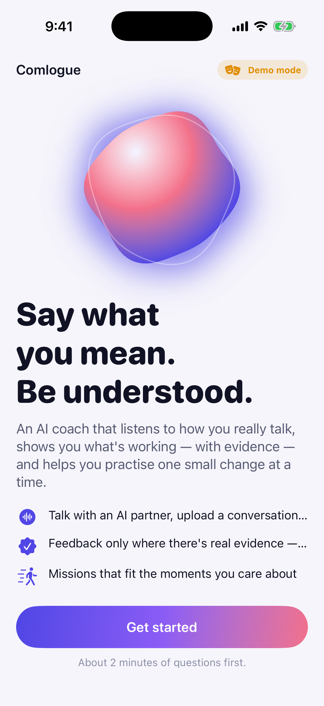 | 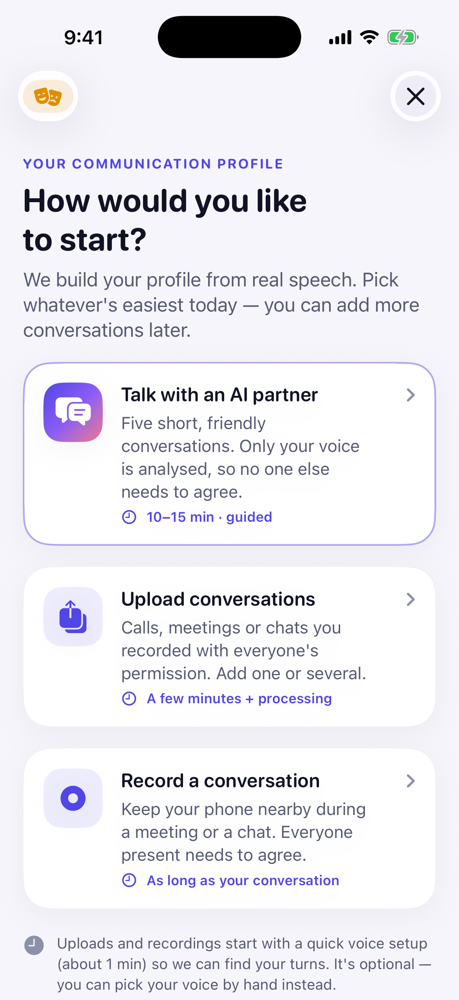 | 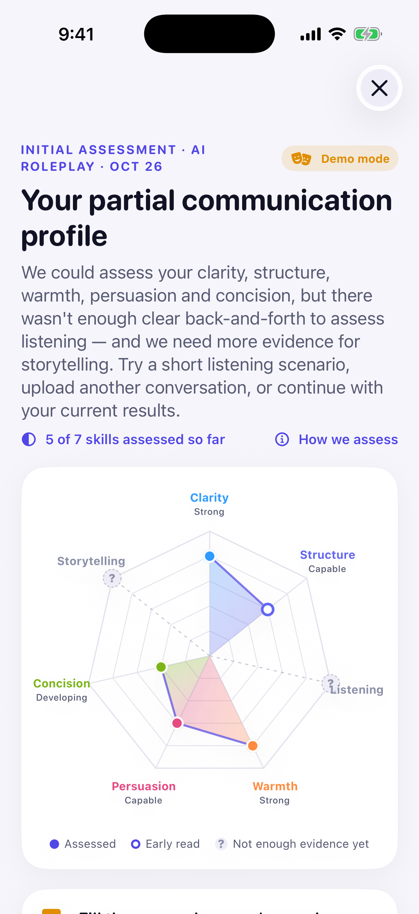 | 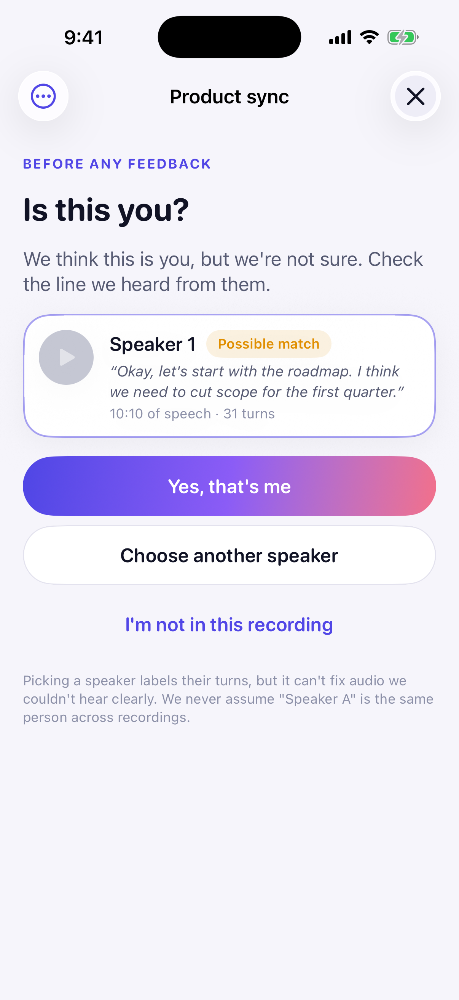 |

| Today | Course | Mission | Spar |
| :---: | :---: | :---: | :---: |
| 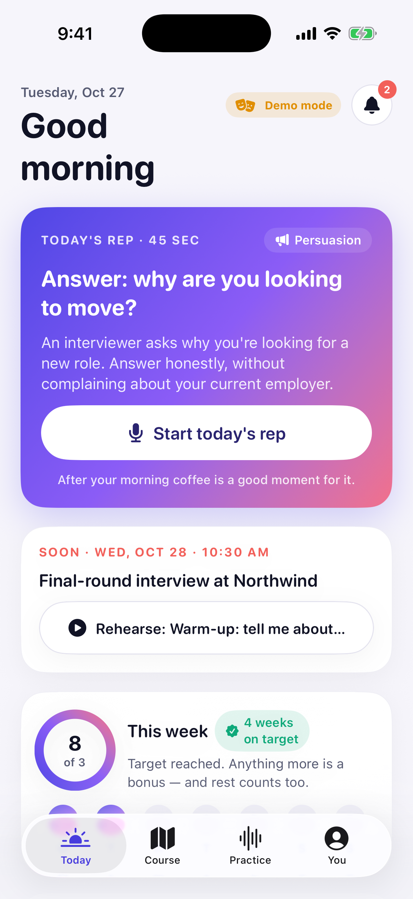 | 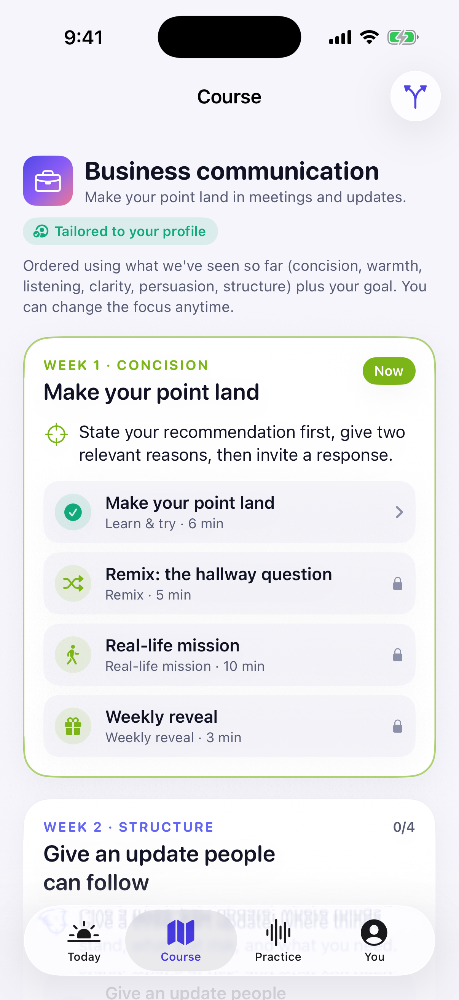 | 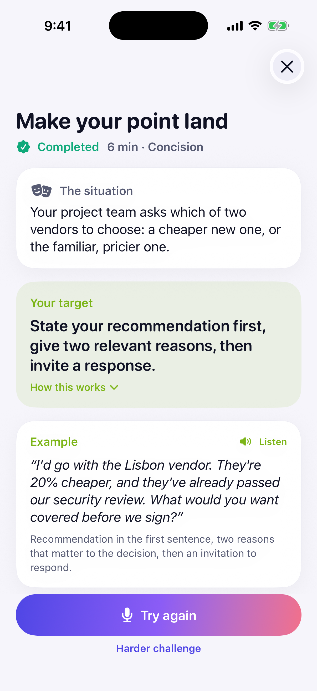 | 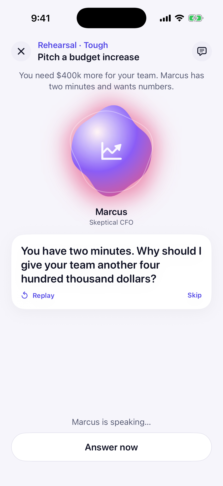 |

| Practice | You | Pro | Dark mode |
| :---: | :---: | :---: | :---: |
| 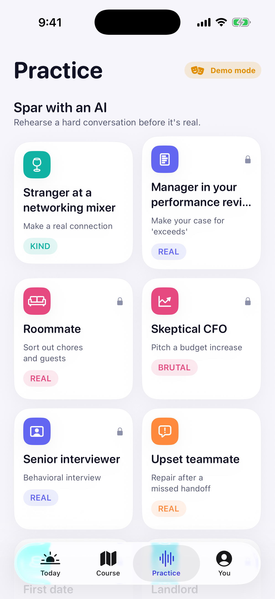 | 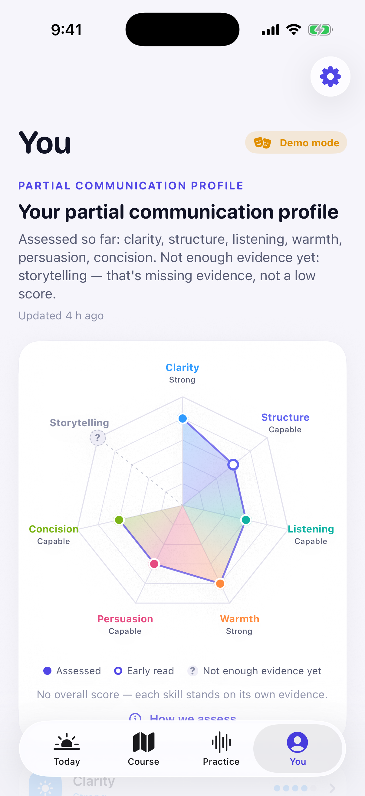 | 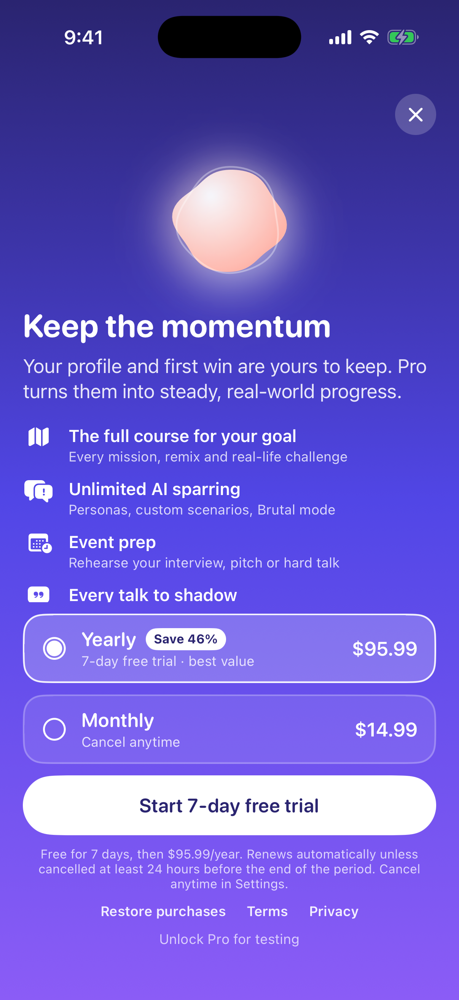 | 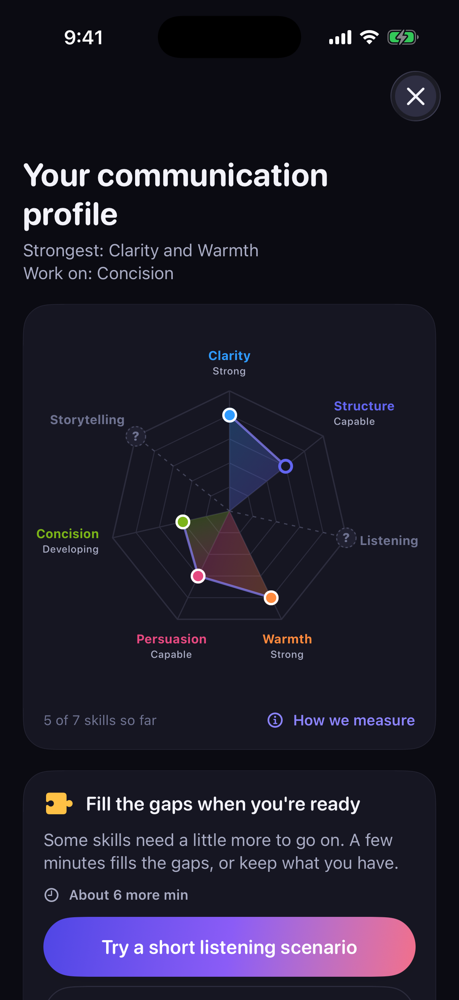 |

## What's inside

- **Three ways to start:** a guided AI conversation (five short activities, 10–15 min), uploading recordings,
  or recording a live conversation. Each one passes audio-quality, speaker-attribution and evidence checks.
- **An evidence-gated communication profile** across Clarity, Structure, Listening, Warmth, Persuasion,
  Concision and Storytelling:
  - Each skill shows a level and, separately, how confident we are, plus the moments that support it.
  - Skills without enough evidence show "Not enough evidence yet". There is no overall score.
- **Voice matching that asks first:** an optional, consented voice sample, and confirmation of which speaker
  is you ("Yes, that's me" / "Choose another speaker" / "I'm not in this recording").
- **A course that adapts:** five goal tracks of four weekly modules each. Every module has Learn & try,
  Remix, a Real-life mission and a Weekly reveal. Missions are AI conversations with feedback tied to one
  target behaviour, retries, and before/after comparisons.
- **Practice tools:**
  - Spar with AI personas (Kind/Real/Brutal), get a coach whisper between turns, and a report that suggests
    rewrites of key moments.
  - Shadow great talks line by line with an on-device rhythm match.
  - Rehearse an upcoming event.
  - Get a debrief of a recorded meeting.
- **Privacy built in:** just-in-time recording consent with regional rules, and deletion of each recording,
  the voice sample, or everything.
- **Siri and Shortcuts:** "Start today's mission", "Quick practice" and "Record a conversation".
- **Honest when things go wrong:** unclear audio, an uncertain speaker or a server-side failure leads to a
  specific next step ("Try again", "Choose another speaker", a short gap-filling scenario), never a low score.

## Quick start

### 1. Run the backend

```bash
cd backend
python3 -m venv .venv && source .venv/bin/activate
pip install -r requirements.txt
cp .env.example .env          # add OPENAI_API_KEY to use real AI; leave it empty for demo mode
uvicorn app.main:app --reload --host 0.0.0.0 --port 8000
```

You also need `ffmpeg` (`brew install ffmpeg` or `apt install ffmpeg`). Or run `docker compose up --build` in
`backend/`. See [`backend/README.md`](backend/README.md) for configuration, deployment and costs.

Without an `OPENAI_API_KEY` the backend runs in **demo mode**. Every flow works offline with clearly labelled
simulated output, and the app shows a "Demo mode" badge.

### 2. Run the iOS app

1. Open `ios/Comlogue.xcodeproj` in Xcode 16 or later.
2. Pick an iPhone simulator and press Run. Debug builds talk to `http://localhost:8000`.
3. On a physical iPhone, set your Mac's local IP (e.g. `http://192.168.1.20:8000`) in
   **Settings → Developer → Server**, or change the `API_BASE_URL` build setting.
4. To try purchases locally, the scheme uses `ios/Comlogue.storekit`. Edit the scheme if Xcode doesn't pick
   it up.

Set your team under *Signing & Capabilities* before running on a device.

## Tests

```bash
cd backend && pytest -q            # backend (mock AI, synthetic audio)
cd ios && swift test               # app core: models, API client, audio math, contract tests
```

`backend/scripts/export_contract_fixtures.py` captures real API responses into `contract-fixtures/`. The
Swift contract tests decode them with the app's own models, so the app and backend can't drift apart.

CI (`.github/workflows/ci.yml`) runs the backend tests, then the Swift core and contract tests on Linux
against fixtures that backend just exported. It also builds and smoke-tests the backend Docker image, and
does a full Xcode build of the app for the iOS Simulator on macOS.

## Repository layout

```
backend/            FastAPI app, AI pipeline, tests, Dockerfile
contract-fixtures/  Real API responses used by the Swift contract tests
docs/               Spec, decisions, API contract, architecture
ios/
  Comlogue.xcodeproj
  Comlogue/         App sources (App, Core, Platform, DesignSystem, Features, Resources)
  CoreTests/        SwiftPM tests for the platform-independent core
  Package.swift     Builds Comlogue/Core as a package for testing
```

## Not in this version

The social layer from the early concepts (communities, pods, live rooms, DMs), leaderboards, and real-time
earpiece coaching are deferred. So is cloning a real person's voice, which raises consent issues. The
reasons are in [`docs/PRODUCT_DECISIONS.md`](docs/PRODUCT_DECISIONS.md#10-extra-practice-beyond-the-spec-from-the-earlier-concepts).
