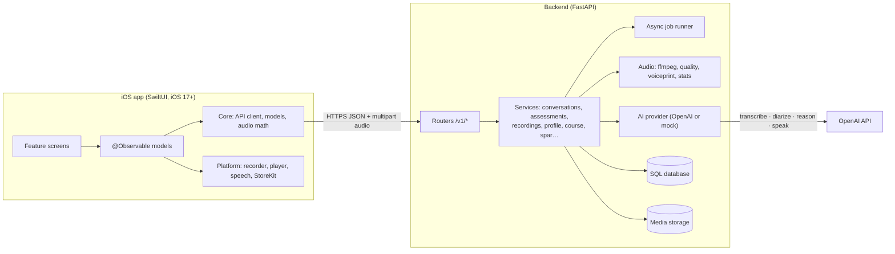

# Architecture

## iOS app (`ios/`)

| Layer | Folder | Notes |
| --- | --- | --- |
| App shell | `Comlogue/App` | `AppModel` holds the session, cached server data and the active full-screen flow. `FlowHost` routes flows. |
| Core | `Comlogue/Core` | Foundation-only. Codable models that mirror `docs/API.md`, `APIClient` (async/await, multipart, re-auth), `AudioMath` (VAD, pauses, quality issues, rhythm match). Also built as a SwiftPM package (`ios/Package.swift`) and tested on Linux. |
| Platform | `Comlogue/Platform` | AVFoundation recorder and player, on-device speech fallback, Keychain identity, StoreKit 2, reminders, haptics. |
| Design system | `Comlogue/DesignSystem` | Theme tokens (light/dark), pill buttons, cards, `VoiceOrb`, `CommunicationWeb`, `SuggestionTimerRing`, recording status bar. |
| Features | `Comlogue/Features/*` | Onboarding, conversation engine, assessment, recordings, results, today, course and missions, practice, you, settings, paywall. |

Key behaviours:

- **One conversation engine.** `ConversationScreen` and `ConversationModel` serve the guided assessment, missions and spar. Each turn is recorded on the user's isolated microphone, sanity-checked on device, then uploaded. The server transcribes it, checks it and replies with the partner's next line as TTS audio. The app falls back to on-device speech when there is no audio.
- **The timer never stops the recording.** `AudioRecorder` has no auto-stop. The ring turns into an overtime counter.
- **Honest recovery.** Unusable turns or recordings produce specific issues and recovery actions, never a score.
- **Configurable server.** The `API_BASE_URL` build setting (Debug defaults to `http://localhost:8000`) can be overridden at runtime in Settings → Developer → Server.

## Backend (`backend/`)

- **FastAPI** with SQLAlchemy (SQLite by default, Postgres via `DATABASE_URL`) and local media storage behind an interface ready for S3.
- **Auth**: anonymous device tokens (HMAC-signed). Sign in with Apple can be layered on later.
- **AI provider interface** with two implementations:
  - `openai`: `gpt-4o-transcribe` (with logprobs for confidence) for turns, `gpt-4o-transcribe-diarize` with the consented voice reference as a known speaker for recordings, a reasoning model for evidence assessment and feedback via Structured Outputs, a fast model for live partner replies, and `gpt-4o-mini-tts` for partner voices. Each role has a model fallback chain.
  - `mock`: deterministic and offline, used by tests and demo mode. Responses carry `demo_mode: true` and the app shows a badge.
- **Pipelines** run as async background jobs. Clients poll the resource; restarts re-queue stuck work.
  - Recording: decode → quality (10-second windows) → diarize → attribution rules → [wait for confirmation] → evidence assessment → debrief.
  - Assessment: turns are already checked → finalize → evidence assessment across activities → style eligibility → profile update.
- **Evidence guards**: deterministic minimums per dimension override the model. No opportunity, or too little attributed speech, gives `not_enough_evidence` with a null level.

## Data and privacy

- Audio, transcripts and results belong to the user and are deletable individually or all at once (`DELETE /v1/me`).
- The voice reference is opt-in, versioned and consented, stored separately, and deletable without touching recordings.
- Other speakers' speech is used only as context and never enters the user's profile.
- Secrets live in environment variables only. The app never holds the OpenAI key.

## Contract testing

`backend/scripts/export_contract_fixtures.py` captures real responses from the backend in mock mode into `contract-fixtures/`. `ios/CoreTests/ContractTests.swift` decodes every fixture with the app's own models and checks the spec's invariants (no overall score, no level without evidence, no fractional-second timestamps).
