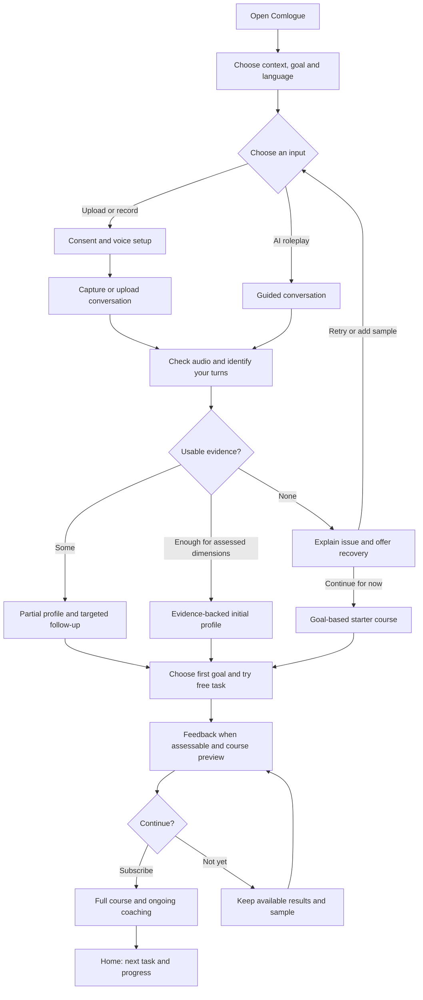
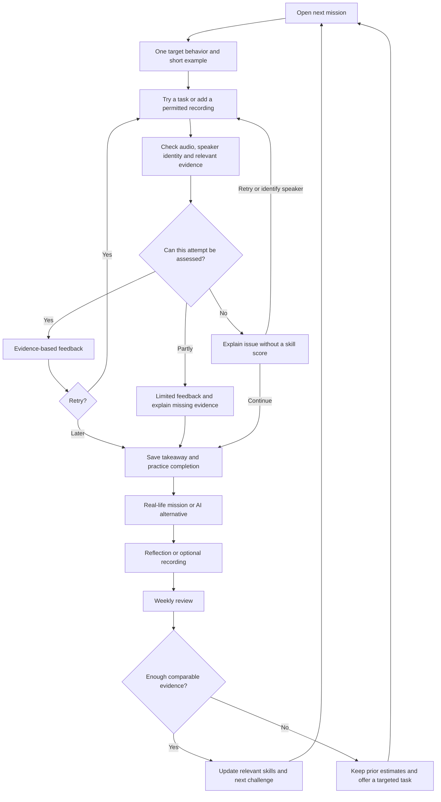

# Comlogue — product spec (from Notion)

> Source: the "Comlogue" Notion page (fosterconsulting workspace), pasted by the product owner on 2026‑10‑26.
> Kept here verbatim-in-substance so engineering, design and AI prompts share one reference.
> Where this spec and the earlier "Ummless" visual concepts disagree, **this spec wins**.

## Standing rules (headline)

Before feedback, check audio usability, identify the user's speech using a consented voice reference or
manual speaker confirmation, and check evidence for each dimension. Show partial results when possible.
Unclear audio, uncertain identity or missing opportunities lead to recovery or **"Not enough evidence yet,"**
never a low score. Users may start a goal-based course while filling gaps. **An overall numeric score is
deferred** until the scoring method and coverage requirements are validated.

---

## 00 — Product overview

**Who is it for:** students over 25.

**Communication web (7 dimensions):** Clarity · Structure · Listening · Warmth · Persuasion · Concision · Storytelling.

### Assessment prerequisites

Before personal feedback, check audio usability, attribution of speech to the user, and evidence for each
of the seven dimensions. Set up a consented voice reference for automatic matching, or let users identify
their speaker manually. Return a supported initial or partial profile; missing evidence is not a low skill
score. If nothing is assessable, offer another sample, targeted AI practice or a goal-based starter course.

---

## 01 — Product Experience

When someone lands on the app they have a choice. They can either **upload multiple conversations**, keep
the **phone recording during a meeting or a conversation** they're having with someone else, or **answer a
series of roleplay questions**.

*(Open question: based on location we tell them recording rules in their state — do we do this actively or
passively? Would actively doing it deter participation?)*

Users can upload, record a conversation or use guided AI roleplay. Each route passes audio‑quality,
speaker‑attribution and evidence checks. Real conversations can provide natural context, but are not
automatically better data. Give a complete or partial initial profile only where supported; otherwise
explain what is missing and offer recovery or a goal‑based starter course.

Tell them upfront the guided assessment takes **10–15 minutes**.

"Talk for 5 min about XYZ" — a timer starts and you can see it running out, but **the recording doesn't
stop when the time is up**; they can keep talking and we keep recording. Time is a suggestion and that's
clear.

### Guided assessment activities

| Activity | Initial prompt | Dynamic follow-up | Main dimensions |
| --- | --- | --- | --- |
| **1. Meet someone new** · 1–2 min | "We've just met at a friend's gathering. What's something you've been spending time on lately?" | Ask about one specific detail they mentioned, then offer a little information about the AI character so they can respond | Clarity, warmth, listening, concision |
| **2. Explain an interest** · 2 min | "Pick something you know or enjoy. Explain it to me as someone completely new to it." | Ask a plausible clarification, then: "What's the main thing you'd want me to remember?" | Clarity, structure, concision |
| **3. Respond to someone** · 2–3 min | AI character: "I joined a new team a month ago. Everyone's friendly, but I still feel outside the group. Yesterday I had an idea and didn't say anything." | Respond to what the user actually says. If they offer advice immediately, the character can clarify: "I think I mostly wanted to talk it through first." | Listening, warmth, responsiveness to feedback |
| **4. Make a case** · 2–3 min | "Suggest an activity we could do together this weekend and try to get me interested." | Raise one reasonable objection: time, cost, or preference. Give the user a chance to adapt | Persuasion, listening, structure, concision |
| **5. Tell a story** · 2–3 min | "Tell me about a time something didn't go as planned. It can be funny, ordinary, or meaningful." | Ask about a missing detail or consequence: "What happened next?" or "What made that moment stick with you?" | Storytelling, structure, clarity; possible style evidence |

### Pre-result questions

- **Where would you most like to communicate better?** Friends/social situations, networking, meetings, interviews. (RANK)
- **What would you like to feel easier?** Explaining myself, contributing, connecting, persuading, being concise. (tick all that apply)
- **Which language would you like to use?** (drop down)

Goal areas (see 05): Negotiation · Business communication · Conversational communication · Storytelling · Public communication.

### Voice and evidence steps in onboarding

Choose goal and language → choose upload, recording or AI roleplay → complete required recording/analysis
consent → set up a consented voice reference or choose manual speaker identification → obtain the
conversation → check audio and identify the user's turns → assess evidence separately for each dimension →
show supported results and offer the smallest follow-up for gaps.

For AI roleplay, the isolated user microphone channel can identify turns without a saved voice reference.
Still check background speakers and audio quality. A saved reference is optional and requires permission;
the short enrollment prompt is not itself a skill assessment.

**First upload:** play the proposed user-speaker clip and ask for confirmation. On later uploads, reuse the
reference, recheck uncertain matches and always allow correction. Offer "Choose another speaker" and "I'm not
in this recording." Never assume "Speaker 1" is the same person in different files.

**Poor recording:** explain the specific problem, retain usable sections, and offer retry, a different
upload, quieter recording or AI practice. Manual speaker selection does not make unclear audio usable.

**Incomplete profile:** show supported dimensions and mark the others "Not enough evidence yet." Ask only the
relevant follow-up from the five activities above. If no dimensions can be assessed, offer a goal-based
starter course without pretending an assessment has been completed. Enrollment and recovery add time; show
their estimates separately from the proposed 10–15 minute guided assessment.

**Example message:** "We could assess how you explained your idea, but there wasn't enough clear
back-and-forth to assess listening. Try a short listening scenario, upload another conversation, or continue
with your current results."

### Proposed journey: from first visit to the course

*Design proposal for discussion.* Give users a useful insight and one practical win before asking them to
commit to the full course. The course adapts to their goal and observed needs; users can change the
recommended focus.

- **Baseline:** show Clarity, Structure, Listening, Warmth, Persuasion, Concision and Storytelling. Mark
  dimensions with insufficient evidence as "Not enough evidence yet." Offer a short targeted roleplay when a
  recording leaves gaps; do not block the entire course.
- **Style:** offer an initial description when there is enough evidence. Charisma style and conversational
  twin remain exploratory features, not requirements for entering the course.
- **First win:** when the baseline supports it, use a specific moment from their recording. Otherwise choose
  a starter task from their stated goal. Give personal feedback and comparisons only when the attempt is
  assessable.
- **Access proposal:** baseline, one practice task and course preview are free; the full course is paid. The
  existing 15 dollars/month idea is a pricing hypothesis to test, not a finalized price. Show the price and
  terms before purchase.
- **Returning users:** go directly to their next task. They can also revisit completed lessons, choose
  another module, change goals or add a new conversation. No repeat onboarding.
- **Recording path:** explain consent before recording or uploading; allow AI practice if the user cannot
  record others. The diagram's consent step does not itself establish legal compliance.

### Proposed task loop: make improvement worth coming back for

**The reason to return:** "I noticed something about how I communicate, tried a small change, and can see
what improved." Each session should end with a useful takeaway and a clear stopping point.

#### What one task contains

Every task has a relevant situation, one observable target behavior, a suggested duration, a clear finish
action, feedback tied to the attempt, and an optional retry. The timer is a suggestion; it never silently
stops or extends recording. Recording status, pause and stop remain visible.

**Example mission: "Make your point land."**

1. **Context:** "Your project team asks which option to choose."
2. **Target:** state your recommendation, give two relevant reasons, then invite a response.
3. **Attempt:** respond to the AI teammate; it raises one reasonable objection.
4. **Feedback:** show where the recommendation appeared and whether the reasons addressed the decision.
   Suggest one change.
5. **Retry:** compare the two attempts against the same target. A shorter answer is not automatically a
   better one.
6. **Transfer:** use this approach in your next meeting, or try a different AI scenario. Reflect on what
   happened.

#### A starting weekly rhythm to test

| Mission | What the user does | Reward |
| --- | --- | --- |
| Learn and try | One short example and an initial attempt | A personal insight they can use immediately |
| Remix | Apply the same skill to a different person or situation | See that the skill transfers beyond a memorized answer |
| Real-life mission | Try it in an actual conversation, or choose an AI alternative | Connect practice to an upcoming meeting, interview or social moment |
| Weekly reveal | Review attempts, reflections and any new recordings | A concrete progress example and a choice of next focus |

#### Features that make the loop engaging

- **One obvious next action:** a prominent "Start today's mission" card, with a lighter two-minute option.
- **Personal relevance:** let users select an upcoming event so tasks help with something they already care about.
- **Visible progression:** a course map, completed missions and saved before-and-after attempts. Keep
  practice completion separate from demonstrated skill.
- **Variety within a skill:** switch between storytelling, objection handling, explaining, listening and
  real-life missions as appropriate to the current goal.
- **Flexible consistency:** user-chosen weekly practice targets, optional reminders and an easy return after a missed week.
- **Meaningful milestones:** celebrate the first real-life attempt or successful use in a new scenario.
  Update the communication web only when new evidence supports it.
- **User control:** allow task swaps, skipping, feedback corrections and an optional harder challenge.
  Missing a day does not erase learning.

**What to test in the pilot:** first-task completion, voluntary retries, return for the next mission,
real-life application, and improvement on a fresh scenario. Treat engagement and learning as separate
outcomes; these flows are design hypotheses, not proven retention effects.

### Voice setup and speaker confirmation

**Purpose:** identify which speech belongs to the user before generating personal feedback. Voice matching
is an estimate, not a guarantee or an identity-authentication feature.

1. Before the first uploaded or recorded conversation is analyzed, explain: "Let's learn your voice so we
   can find your speaking turns." Ask permission to create and retain a voice reference for this purpose.
2. Invite a short, clean solo recording. A 20–30 second prompt is a starting UX proposal to test, not a
   validated minimum. Check that it contains usable speech from one person; let the user listen and retry.
3. Users who decline a saved voice reference can identify themselves manually in each recording. Guided AI
   practice remains available. Reusing a roleplay response as a saved reference requires the same explicit
   permission.
4. For each new conversation, separate speaker turns and compare them with the reference. Show a short
   candidate clip: "Is this you?" Require confirmation on the first conversation and whenever the match is
   uncertain or conflicting; keep correction available on every upload.
5. Offer "Yes, that's me," "Choose another speaker," and "I'm not in this recording." Manual selection
   labels identifiable turns but cannot repair unintelligible audio or inseparable overlap. If the user
   cannot identify their turns, withhold personal assessment of those turns.
6. Reuse the reference on later uploads, but do not assume speaker labels such as "Speaker 1" identify the
   same person across files. Allow re-enrollment when the voice or recording conditions change.
7. Score only turns confidently attributed to the user, using understandable surrounding conversation for
   context. Do not incorporate other participants' behavior into the user's skill profile. Exclude
   uncertain segments and explain reduced coverage.
8. Provide controls to replace or delete the saved voice reference. Deleting it stops future automatic
   matching; existing recordings and derived results have separate, clearly explained deletion controls.
   Correcting speaker attribution triggers reassessment of affected results.

**AI roleplay:** the user's isolated microphone channel can identify their turn without saved voice
matching. Background voices, shared devices and unclear audio still require checking. The setup prompt
itself is not a communication assessment.

### When evidence is missing or the recording is poor

**Three separate checks:** can we understand the audio, can we identify the user's speech, and does the
conversation contain relevant opportunities for each skill? A long, clear recording can still contain too
little user speech or no storytelling/persuasion opportunity.

| State | What the app shows | Next action |
| --- | --- | --- |
| File cannot be processed | "We couldn't open this recording." No skill result. | Retry, upload a supported file, record again or use AI practice. Distinguish processing failure from poor performance. |
| Audio is too unclear | "We couldn't hear enough of your speech clearly." Explain noise, low volume or overlapping voices when detectable. | Suggest a quieter/closer recording, another sample or AI practice. Preserve any independently usable sections. |
| Speaker identity is uncertain | "Which voice is yours?" Play candidate clips. | Confirm or correct the speaker, refresh the voice sample, or select "I'm not in this recording." Do not guess. |
| Too little relevant evidence | "We have an initial impression of your clarity, but need more conversation to assess listening." | Offer a targeted follow-up or another conversation containing the missing opportunity. |
| Some dimensions are assessable | Partial profile, examples and an explicit "Not enough evidence yet" for the others. | Continue with supported feedback and optional targeted tasks. Do not require a new full assessment. |
| No dimensions are assessable | "We don't have enough information for your communication profile yet." | Retry, switch input route or start a course based on the user's selected goal. Label it goal-based rather than assessment-personalized. |

**Results rules:** use "initial assessment" or "communication profile," not "diagnosis." Missing evidence
never means a low score. Display unassessed web axes as unavailable; do not plot them as zero or imply a
complete polygon. Separate evidence confidence from skill level. Do not invent an overall score, strength or
weakness when unsupported. Describe observations as applying to the sampled context.

**Recovery:** preserve successful uploads and answered prompts; explain the specific missing evidence and
offer the smallest useful follow-up. No payment is required to resolve a failed initial assessment. Retry or
continue later without a practice penalty. Existing valid results remain visible with their date and
context, but new unusable audio does not update them.

**Implementation validation still required:** calibrate quality, speaker-match and per-dimension evidence
thresholds in pilot testing. Total recording duration alone is not a pass criterion. Test noise, overlap,
short user turns, different microphones, languages and accents; abstain when uncertain instead of treating
recognition difficulty as poor communication.

---

## Charisma measure

### Evidence and speaker requirements

Charisma/style descriptions must use usable speech attributed to the user. A voice reference supports
speaker matching; it does not measure charisma or personality.

With sparse evidence, show only supported context-specific style observations and mark them provisional. If
evidence is absent or unreliable, show "We need more conversation to describe your style" and offer a varied
conversation or AI interaction. Do not assign a type from the voice-enrollment prompt, poor audio or another
participant's speech.

Communication skill coverage and style coverage are separate: a user may have useful clarity feedback without
enough evidence for a charisma description. Missing style results must not block course access.

---

## 04 — Your conversational twin?

Maybe we can upload various famous people and their speech patterns and the way they communicate from what's
publicly available and give them a conversational twin in certain aspects of likeness? Like how do we do this?

### Eligibility and missing evidence

Only offer a conversational-twin comparison when usable, correctly attributed user speech supports the
specific communication behaviors being compared. Speaker identification through a voice reference is
separate from communication-style similarity; sounding alike does not establish a style match.

If evidence is insufficient, show "Your conversational twin is not ready yet" with a relevant next task. Do
not force a celebrity match or use other speakers' behavior. Keep this optional and exploratory; it never
blocks the initial profile or course.

---

## 05 — Goal setting

Negotiation · Business communication · Conversational communication · Storytelling · Public communication.

Course layout and spend starts at 15 dollars a month. Country-specific communication styles.

### Goals when the assessment is incomplete

Users may choose a goal before any recording is assessable. Base recommendations on supported dimensions and
stated priorities; never interpret a missing score as a weakness.

If evidence is insufficient, label the plan "Based on your goal" and use an optional targeted practice task
to gather the missing evidence. Explain later changes to the recommendation and let the user accept or change
the focus. Voice setup and recording recovery must not prevent choosing a goal.

---

## 06 — Course plan

Course access and adaptation with incomplete evidence:

- Supported profile: recommend a course using observed needs and the user's chosen goal.
- Partial profile: use supported dimensions, leave others unassessed and offer targeted tasks to fill gaps.
- No assessable profile: offer a clearly labeled goal-based starter course. Do not claim it is personalized
  to diagnosed weaknesses.
- Apply the audio, speaker-attribution and evidence checks to every new recording and voice task. Offer
  manual speaker confirmation or another sample when needed.
- Unusable recordings do not lower scores, erase progress or force repeat onboarding. Preserve valid previous
  estimates with date and context.
- Update skills and difficulty only when new, relevant evidence supports the change. Self-reported reflection
  can inform goals but is not equivalent to an audio-verified skill result.
- Baseline recovery and retries remain available without a purchase. The proposed paid full course is
  separate from resolving an assessment failure.
