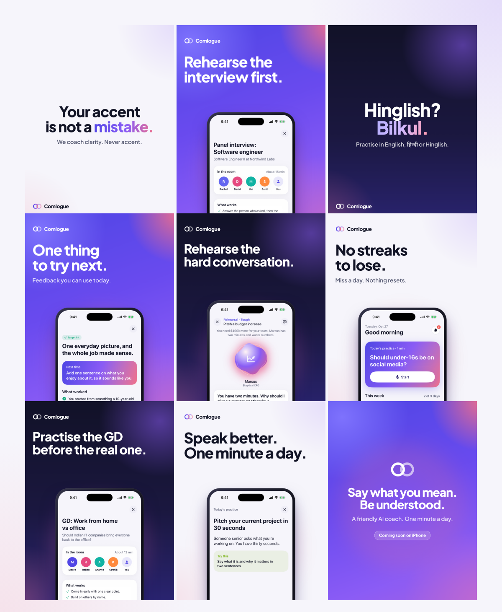

# Comlogue on Instagram

Launch material for the US and India: nine grid posts, three carousels, three stories, a reel and the profile art.
Everything is rendered from HTML templates in `src/`, so a change of copy or a new app screenshot is one command.



## What's here

| Folder | What | Size |
| --- | --- | --- |
| `posts/` | Nine feed posts, numbered in posting order | 1080 × 1350 (4:5) |
| `carousels/meetings/` | *5 ways to sound clearer in meetings*: cover, five tips, the app | 7 × 1080 × 1350 |
| `carousels/gd-guide/` | *How to stand out in a GD*, for placement season in India | 7 × 1080 × 1350 |
| `carousels/how-it-works/` | Pick a goal, practise for one minute, get one thing to try | 5 × 1080 × 1350 |
| `stories/` | Today's prompt (add a poll sticker), GD tonight, coming soon | 1080 × 1920 (9:16) |
| `reels/` | `one-minute.mp4` (about 10.5 s, silent: add music in Instagram), its cover and its five frames | 1080 × 1920 |
| `profile/` | Profile picture and five highlight covers | 1080 × 1080, 1080 × 1920 |
| [`captions.md`](captions.md) | A caption, hashtags and alt text for every piece, with US and India versions | |
| [`calendar.md`](calendar.md) | The first four weeks | |
| [`reels.md`](reels.md) | Scripts for talking-head reels you can film on a phone | |

## The design rules

The app went minimal for the mass market, and so did this:

- **One headline**, at most six words a line and two lines. **At most one line** under it.
- **One phone** with a real app screenshot, rising from the bottom edge. No floating badges, bubbles or chips.
- **The details go in the caption**, not on the image.
- **Three backgrounds** that alternate across the grid: *aurora* (the app's indigo → violet → coral gradient),
  *paper* (lavender white) and *night* (deep indigo).
- **Type:** Plus Jakarta Sans ExtraBold for headlines, SemiBold for the line under them; Noto Sans Devanagari for
  Hindi. Both are OFL-licensed and embedded (`src/fonts/OFL.txt`).
- **Colours:** indigo `#5146E6`, violet `#8B5CF6`, coral `#F2708A`, ink `#111325`, paper `#F6F5FB`.

## Safe zones

- **Feed posts:** the profile grid crops 4:5 posts to 3:4, so copy stays 84 px from the left and right edges.
- **Stories and reels:** Instagram's own buttons cover roughly the top 250 px and the bottom 300 px, so copy
  stays between y ≈ 250 and y ≈ 1600.

## Rendering

```sh
cd marketing/instagram
npm install          # Playwright, once
npm run render       # every PNG and preview.png; `node src/render.mjs posts` renders just the posts
npm run reel         # reels/one-minute.mp4 from the frames (needs ffmpeg)
```

The phones show `docs/screenshots/*.png`, which the screenshot workflow captures from the app (light mode,
demo data). Re-render after new screenshots so the posts always show the current app.

## Before posting

- **Until launch, say "Coming soon on iPhone".** After launch, use Apple's official *Download on the App Store*
  badge, unmodified, from Apple's marketing resources, and follow its guidelines.
- **No made-up proof.** No testimonials, ratings, user counts or "as seen in" until they're real and you have
  permission to use them.
- **The people and companies in the screenshots are fictional demo data** (Priya, Marcus, Northwind Labs). Keep
  it that way: never put a real person's name or conversation on a post without their written permission.
- **Claims stay true to the app:** the daily practice is free; feedback has no overall score; accents and
  Hinglish are never marked as errors; nothing resets when you miss a day.
